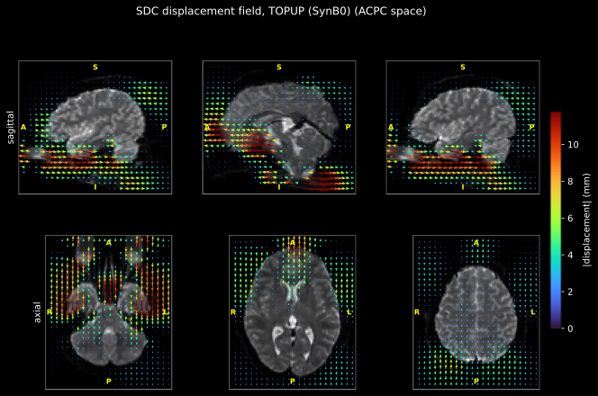

.. include:: ../links.rst

.. _sdc_methods:

####################################
Susceptibility distortion correction
####################################

:func:`qsiprep.workflows.fieldmap.base.init_sdc_wf`

.. raw:: html

    <object type="image/svg+xml" data="../_static/unwarping.svg" style="width: 100%; aspect-ratio: 792 / 939"></object>

Hover over the image to flicker between the distorted and the corrected b=0
of each phase encoding direction; the contours are the subject's T2w. Both
directions end up on the same image, which is the sign that the correction
worked.

Echo-planar images are stretched and compressed along the phase encoding
axis where the magnetic field is inhomogeneous. Correcting this needs an
estimate of the field, which can come from a fieldmap, from images acquired
with opposite phase encoding, or from an undistorted image made from the
anatomy. *QSIPrep* decides which one a series gets from the metadata (see
:ref:`linking_fieldmaps`), prefers reverse phase encoding over a GRE fieldmap
when both are linked, and corrects a series no fieldmap reaches with a
fieldmap-less method: SynB0 + TOPUP by default (``--sdc-fieldmapless-method``,
``--sdc-anat-reference``; ``--force sdc-anat-reference`` uses it for every
series). The tool that applies the estimate depends on the head motion
backend:

.. list-table::
   :header-rows: 1
   :widths: 28 24 24 24

   * - Estimated from
     - ``eddy``
     - ``tortoise``
     - ``shoreline``
   * - Reverse phase-encoded b=0 or DWI series
     - TOPUP, inside ``eddy``; optionally refined by DRBUDDI
     - DRBUDDI
     - DRBUDDI
   * - GRE fieldmap
     - Inside ``eddy``
     - Applied after DIFFPREP
     - Applied after SHORELine
   * - Synthetic b=0 (default: ``topup`` with ``synb0``)
     - TOPUP, inside ``eddy``
     - TOPUP after DIFFPREP
     - TOPUP after SHORELine
   * - Synthetic b=0 or inverted T1w (``syn``)
     - SyN
     - SyN
     - SyN
   * - Synthetic b=0 or T2w (``unpile``)
     - unpile after ``eddy``
     - unpile after DIFFPREP
     - unpile after SHORELine

The correction that ran is named in the visual report, in the methods
boilerplate, and in the ``EstimationMethod`` of the displacement map
derivative (see :ref:`outputs`).

.. _sdc_topup:

*****
TOPUP
*****

TOPUP :footcite:p:`topup` estimates the field from b=0 images acquired with
different phase encoding directions or readout times. From each distortion
group of the correction unit, *QSIPrep* selects b=0 images, preferring those
native to the series being corrected over borrowed ones, and passes them to
TOPUP. The field is applied by ``eddy`` inside its own resampling, so it
never exists as a standalone correction; for the displacement map
derivative it is rebuilt from TOPUP's field in Hz. TOPUP is only available
with ``--hmc-method eddy``.

.. _drbuddi_tool:

*******
DRBUDDI
*******

:func:`qsiprep.workflows.fieldmap.drbuddi.init_drbuddi_wf`

DRBUDDI :footcite:p:`drbuddi`, from TORTOISE, estimates the field by
registering the two phase encoding directions to each other after head
motion correction. With reverse phase-encoded DWI *series* it uses the b=0
image and the fractional anisotropy image of each direction together, in a
multi-modal registration; with a lone reverse b=0 (an ``epi`` fieldmap) it
registers the b=0 images. A T2w image is added to the registration when one
is available and ``t2w`` is not ignored; it is first placed in the b=0
frame by an ``antsAI`` rotation search followed by a masked rigid
``antsRegistration`` (see :ref:`b0_reg`), because DRBUDDI's own rigid
initialization cannot recover large rotations. Intensities are then adjusted with
TORTOISE's least-squares restoration (see :ref:`jacobian_methods`).

DRBUDDI runs after ``eddy``, DIFFPREP or SHORELine, and processes exactly one
matched pair of phase encoding directions per invocation. On the ``eddy``
backend it can either replace TOPUP (``--sdc-method drbuddi``) or refine it
(``--sdc-method topup+drbuddi``), in which case the refinement is written as
a separate ``desc-sdcrefinement`` displacement map.

.. raw:: html

    <object type="image/svg+xml" data="../_static/sdc_fa.svg" style="width: 100%; aspect-ratio: 792 / 470"></object>

The report also shows the fractional anisotropy image before and after the
correction (hover to flicker). The FA is what DRBUDDI matched between the
two directions, so distorted white matter should straighten out in it even
where the b=0 is featureless.

.. workflow::
    :graph2use: orig
    :simple_form: yes

    from qsiprep_docs import example_unit
    from qsiprep.workflows.fieldmap.drbuddi import init_drbuddi_wf

    wf = init_drbuddi_wf(example_unit('pepolar'), t2w_sdc=False)

.. _sdc_gre:

*************
GRE fieldmaps
*************

:func:`qsiprep.workflows.fieldmap.phdiff.init_phdiff_wf`,
:func:`qsiprep.workflows.fieldmap.fmap.init_fmap_wf`

A phase-difference or two-phase fieldmap is unwrapped with ROMEO
:footcite:p:`romeo` as implemented in niimath :footcite:p:`niimath`, and
converted to a field in Hz :footcite:p:`jezzard1995`; a Hz fieldmap is
masked, median-filtered and extrapolated beyond the brain mask (the distorted
EPI brain reaches past the undistorted fieldmap brain, where the field is
strongest). The magnitude image is rigidly registered to the distorted b=0
reference. A rigid fit to a distorted image is pulled along the phase encoding
axis, so a second registration follows against the reference unwarped with the
field the first brought in, and whichever pass scores better on its own unwarped
reference is kept (``--force one-pass-sdc`` skips the second pass). The field is resampled
through the transform, turned into a displacement along the phase encoding
axis using the series' ``TotalReadoutTime`` and applied with ANTs
(:func:`qsiprep.workflows.fieldmap.unwarp.init_sdc_unwarp_wf`).
Since 26.1 none of this needs FSL, so GRE fieldmaps work in the FSL-free
image as well.

With ``--hmc-method eddy``, the field is handed to ``eddy`` and applied
inside its model. With the other backends it is applied to the
motion-corrected series at the final resampling, and an unwarped b=0
reference is computed for coregistration.

.. workflow::
    :graph2use: orig
    :simple_form: yes

    from qsiprep_docs import example_unit
    from qsiprep.workflows.fieldmap.base import init_sdc_wf

    wf = init_sdc_wf(example_unit('phasediff'))

.. _sdc_gre_init:

Starting DRBUDDI and unpile from a GRE fieldmap
===============================================

Registration-based correction infers the field by matching images, which is
ambiguous where the field piles several voxels' signal into one or drops it
out. A GRE fieldmap measures the field directly. So when a series is
corrected by DRBUDDI and a GRE fieldmap also lists it, the GRE-derived warp
is the registration's starting point: the initial transform of the primary
direction and, negated, of the reverse direction, held fixed through the
registration's multi-resolution pyramid so that each stage estimates a
residual correction on top of it rather than smoothing it away. When the
series is corrected by unpile against the T2w (:ref:`sdc_unpile`), the GRE
field in Hz is the prior of the fit: unpile keeps it and refines its position
against the b=0. Its shim-polynomial and residual terms are not used: on the
simulated fieldmap fixture each lowered the amplitude of a well-registered
field. Against the synthetic b=0 the fieldmap is applied as given, since the
synthetic image carries part of the distortion and refining against it pulls
the field toward that bias.

This happens whenever the linkage is present, on every backend that runs
DRBUDDI (except when DRBUDDI only refines TOPUP) and on unpile when it is
forced over the GRE fieldmap. How to set up the sidecars is in
:ref:`gre_init_flags`. The report's distortion correction entry ends in
``(GRE-initialized)`` or ``(GRE-refined)`` and the boilerplate describes it.

.. _sdc_synb0:

*****
SynB0
*****

:func:`qsiprep.workflows.fieldmap.synb0.init_synb0_wf`,
:func:`qsiprep.workflows.fieldmap.synb0.init_synb0_topup_wf`

The default fieldmap-less correction. A synthetic distortion-free b=0 image is
generated from the T1w and the distorted b=0 with the SynB0-DISCO U-Net
:footcite:p:`synb0disco` and stands in for a reverse phase-encoded
acquisition: TOPUP pairs it, as a volume with zero readout time, with the
acquired b=0. With ``eddy`` it joins the TOPUP inputs before ``eddy``. With
DIFFPREP and SHORELine, TOPUP runs after head motion correction, on the
motion-corrected b=0 average and a synthetic b=0 generated from that same
image, so the two share their noise and contrast. TOPUP runs in FSL's LAS+
orientation, and its field becomes a displacement along the phase encoding
axis that is applied at the final resampling.

The U-Net carries part of the distortion of the b=0 it is given into the
synthetic image, so the field TOPUP finds is weaker than the true one. After
DIFFPREP or SHORELine a second pass unwarps the b=0 with the first field (with
Jacobian modulation), generates a new synthetic b=0 from it, and runs TOPUP
again on the original b=0 and the new synthetic one. On four real subjects this
pass lowered the error against a reverse phase-encoded reference in every one;
``--force one-pass-sdc`` skips it.

The report shows the acquired and synthetic b=0 as a flicker pair, and the
correction TOPUP estimated from them. Requires a T1w (``--anat-modality
T1w``) and a ``PhaseEncodingDirection`` and ``TotalReadoutTime`` on the DWI
series; a series without them is an error unless ``--sdc-anat-reference
none`` is given.

.. raw:: html

    <object type="image/svg+xml" data="../_static/synb0_acquired.svg" style="width: 100%; aspect-ratio: 1108 / 470"></object>

The acquired b=0 and the synthetic one the U-Net produced from it and the
T1w (hover to flicker). Nothing has been corrected yet; this view is for
judging whether the synthetic target is credible. The contours are the
white matter of the T1w.

.. raw:: html

    <object type="image/svg+xml" data="../_static/synb0_sdc.svg" style="width: 100%; aspect-ratio: 1108 / 470"></object>

The correction TOPUP estimated from that pair, before and after. This is
the same session as the DRBUDDI example above, but with only one phase
encoding direction and SynB0 as the reference.

    The displacement map TOPUP estimated from the acquired and synthetic
    b=0. Compare it with the DRBUDDI map of the same session in
    :ref:`outputs`: the field is recovered without a reverse phase-encoded
    acquisition, with the largest displacements in the same places.

.. _sdc_unpile:

******
unpile
******

:func:`qsiprep.workflows.fieldmap.unpile.init_unpile_sdc_wf`

Selected with ``--sdc-fieldmapless-method unpile``, with every head motion
method. `unpile <https://unpile.readthedocs.io>`__ :footcite:p:`unpile`
estimates the field from the motion-corrected b=0 and an undistorted
reference with a model of the EPI readout: the reference is displaced along
the phase-encoding axis the way the readout displaces it, signal pile-up
included, and the field that makes it match the b=0 is fitted on a
coarse-to-fine B-spline grid with a bending-energy penalty. The reference is
the synthetic b=0 above (``--sdc-anat-reference synb0``), compared by the sum
of squared differences with a fitted gain, or the subject's T2w (``t2w``),
compared by local normalized cross-correlation. The field is converted to a
displacement field, Jacobian-modulated like the other corrections, and
applied in the final resampling.

With the T2w, the image is placed in the b=0 frame first, as for DRBUDDI: an
``antsAI`` rotation search, then a masked rigid ``antsRegistration`` to the
b=0. unpile then fits a rigid refinement of that position together with the
field, so a placement biased by the distortion is corrected rather than
inherited. The fit runs on a grid at about two thirds of the EPI voxel (no
finer than 1.5 mm), which keeps the detail of the T2w that the metric needs;
the field is brought back onto the EPI grid afterwards. With the synthetic
b=0, a second pass regenerates the synthetic image from the b=0 the first
field unwarped, as SynB0 + TOPUP does; ``--force one-pass-sdc`` skips it. A
GRE fieldmap that also lists the series is the prior of the fit
(:ref:`sdc_gre_init`). The fit's settings and scores are written as the
``desc-unpile_qc.json`` derivative, and the fitted position of the T2w as an
ITK transform in the working directory.

.. workflow::
    :graph2use: orig
    :simple_form: yes

    from qsiprep_docs import example_unit
    from qsiprep.workflows.fieldmap.unpile import init_unpile_sdc_wf

    wf = init_unpile_sdc_wf(example_unit('single'), target='synb0')

.. _sdc_syn:

***
SyN
***

:func:`qsiprep.workflows.fieldmap.syn.init_syn_sdc_wf`

With ``--sdc-fieldmapless-method syn``, the fieldmap-less method from
fMRIPrep :footcite:p:`fieldmapless1,fieldmapless2` registers the b=0 to
the T1w with its intensity inverted (``--sdc-anat-reference invt1w``) or to
the synthetic b=0 above (``synb0``, no inversion needed), with the
deformation constrained to the phase encoding axis and regularized by an
average fieldmap template :footcite:p:`fieldmapless3`. It runs after any
head motion backend.

.. _jacobian_methods:

********************
Intensity modulation
********************

Correcting a spatial distortion moves signal between voxels, so the
corrected image has to be rescaled by the local volume change, or regions
the acquisition compressed stay too bright :footcite:p:`rohde2004`.
*QSIPrep* follows TORTOISE's two implementations. **Jacobian**: each volume
is multiplied by the derivative of the composed displacement along the phase
encoding axis, used when only one phase encoding polarity was acquired (GRE
and SyN fieldmaps, unpile, SynB0 + TOPUP after DIFFPREP or SHORELine, and
single-polarity DIFFPREP runs). **LSR**: when both
polarities exist, DRBUDDI computes the harmonic mean of the two corrected
b=0 images and each direction's volumes are scaled by the ratio of that
reference to their own corrected b=0; this replaces the Jacobian entirely.
Head motion, coregistration and normalization are never modulated: a rigid
realignment is not a volume change, and modulating by a normalization warp
would corrupt the signal.

============================== ==========================================
Correction                     Modulated by
============================== ==========================================
Gradient nonlinearity          *QSIPrep* (Jacobian; not under LSR)
Susceptibility (TOPUP)         ``eddy`` before ``eddy``, else *QSIPrep*
Susceptibility (DRBUDDI)       *QSIPrep* (LSR)
Susceptibility (GRE)           ``eddy`` on its path, else *QSIPrep*
Susceptibility (SyN)           *QSIPrep* (Jacobian)
Susceptibility (unpile)        *QSIPrep* (Jacobian)
Eddy current (``eddy``)        ``eddy``, internally
Eddy current (DIFFPREP)        *QSIPrep* (Jacobian; not under LSR)
============================== ==========================================

``--ignore jacobian`` disables only the modulation *QSIPrep* itself applies.
``eddy`` modulates whenever its resampling method is ``jac`` (the default);
with ``"method": "lsr"`` in ``--eddy-config`` it does not modulate at all,
and *QSIPrep* cannot retrofit that. The run then warns, and the gap is
recorded in the ``UnmodulatedCorrections`` key of the Jacobian derivative's
sidecar. The weights *QSIPrep* applied are written as the ``desc-jacobian``
derivative described in :ref:`outputs`.

**********
References
**********

.. footbibliography::
